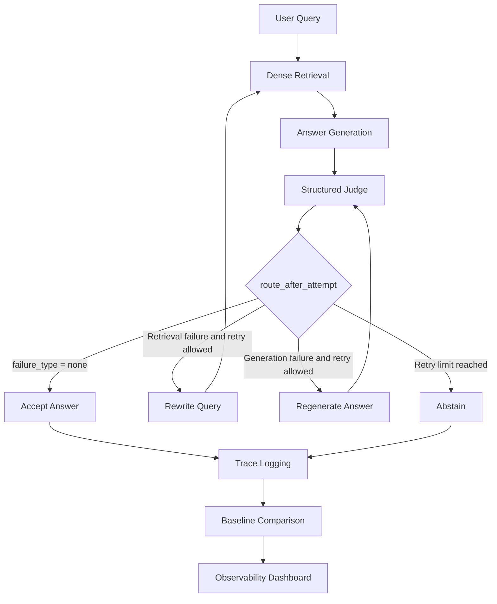
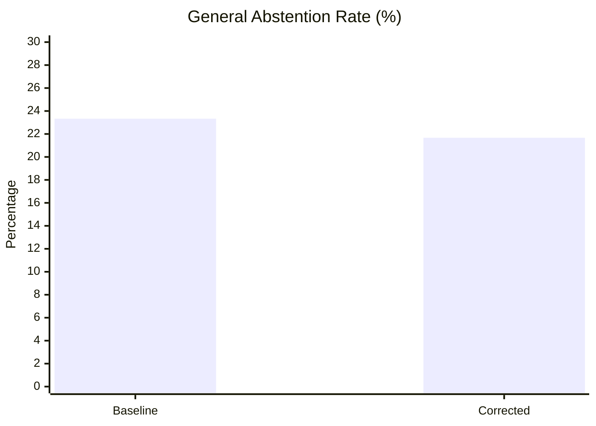
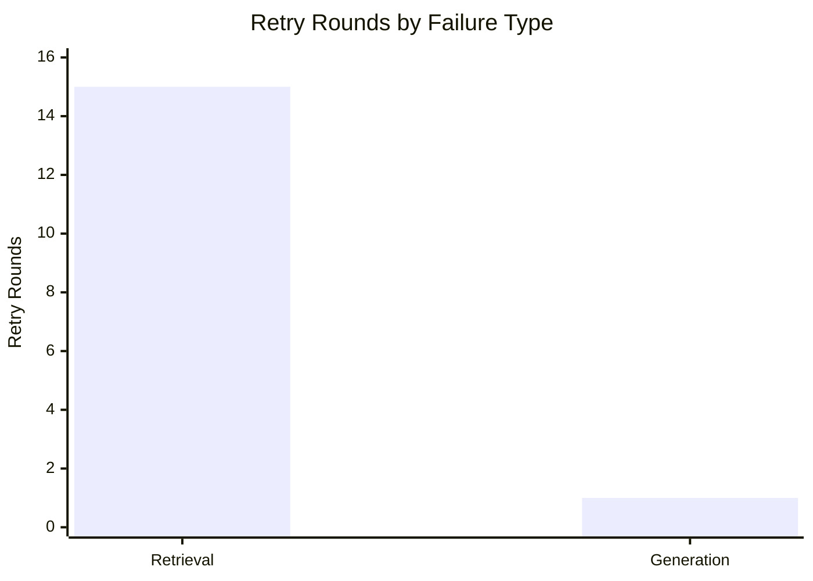

# Agentic RAG Observability & Self-Correction System

An observable Retrieval-Augmented Generation (RAG) system with structured LLM judging, corrective retry workflows, abstention handling, baseline comparison, and an evaluation dashboard.

## Project Overview

This project explores how a RAG pipeline can evaluate its own generated answers, identify retrieval or generation failures, and attempt corrective actions through a controlled retry workflow.

The system includes:

- Dense retrieval using ChromaDB.
- Structured answer evaluation using a judge.
- Failure classification: `retrieval`, `generation`, or `none`.
- Corrective query rewriting and answer regeneration.
- Retry handling using LangGraph.
- Abstention when the retry process cannot obtain an accepted answer.
- Execution trace logging and baseline comparison.
- A read-only Streamlit observability dashboard.
- Offline evaluation of answer correctness, retrieval performance, hallucination proxy, and abstention behavior.

**Important:** Self-correction is not assumed to improve factual accuracy. The evaluation compares the baseline and corrected pipelines to identify actual improvements, unchanged metrics, and limitations.

---

## System Architecture

The judge evaluates the answer against the retrieved context and produces a structured verdict.

| Judge field | Purpose |
|---|---|
| `grounded` | Indicates whether the answer is grounded in the retrieved context. |
| `retrieval_quality` | Evaluates the quality of retrieved context. |
| `answer_quality` | Evaluates the generated answer. |
| `failure_type` | Identifies retrieval, generation, or no failure. |
| `reason` | Explains the judge's decision. |
| `is_abstention` | Indicates whether the generated response is an abstention. |

The retry workflow distinguishes between two failure paths:

- **Retrieval failure:** Rewrite the query, retrieve again, generate a new answer, and judge it.
- **Generation failure:** Regenerate the answer using the same retrieved context and judge it again.

The system allows a maximum of two retry attempts.

---

## Test Results

| Test detail | Result |
|---|---:|
| Test command | `python -m pytest -v --basetemp=.pytest_tmp` |
| Tests passed | 74 |
| Warnings | 2 |
| Warning type | FastAPI `on_event` deprecation warnings |

---

## Evaluation Methodology

The evaluation compares two execution modes:

1. **Baseline:** The original RAG pipeline without corrective retries.
2. **Corrected:** The RAG pipeline with structured judging and corrective retry handling.

### Evaluation Dataset

| Dataset property | Value |
|---|---:|
| Total queries | 60 |
| Adversarial queries | 13 |
| Non-adversarial queries | 47 |
| Baseline evaluation rows | 60 |
| Corrected evaluation rows | 60 |

The adversarial queries test whether the system can avoid providing unsupported answers when the requested information is unavailable or insufficiently supported by the documents.

### Answer Correctness Metric

Answer correctness is evaluated using offline key-term coverage against `expected_answer`.

The evaluation process:

1. Normalize text to lowercase.
2. Remove punctuation and stopwords.
3. Identify expected-answer key terms.
4. Calculate the fraction of expected-answer key terms present in the generated answer.

**Correctness threshold:** `0.6`, configured through `ANSWER_CORRECTNESS_THRESHOLD`.

This is a key-term coverage metric, not semantic answer evaluation. It can miss valid paraphrases or overestimate correctness when expected terms appear without the intended meaning.

Additional rules:

- Abstained answerable queries are counted as incorrect.
- Adversarial queries are not scored for answer correctness.

### Hallucination Rate

The approved offline hallucination proxy uses the following logic:

- Every answered adversarial query counts as a hallucination.
- An answered non-adversarial query counts as a hallucination when its saved `answer_correct` value is false.
- The denominator is the total number of answered queries.

This is a ground-truth evaluation proxy, not a separate semantic hallucination detector or a direct measure of all unsupported claims.

### Other Evaluation Metrics

| Metric | What it measures |
|---|---|
| False Answer Rate | Unsupported answers provided for adversarial queries. |
| Correct Abstention Rate | Correct abstentions on adversarial queries. |
| General Abstention Rate | Total queries classified as abstentions. |
| Recall@K | Retrieval recall against the relevant chunks. |
| Hit Rate@K | Whether at least one relevant chunk was retrieved. |
| Answer Correctness | Expected-answer key-term coverage. |
| Hallucination Rate | Offline ground-truth/key-term coverage proxy. |
| Judge-approved after Retry | Query-level judge acceptance after corrective retries. |

---

## Baseline vs Corrected Results

The following table contains the saved  evaluation results.

### Key Metrics Comparison

| Metric | Baseline | Corrected |
|---|---:|---:|
| False Answer Rate | 0/13 = **0%** | 0/13 = **0%** |
| Correct Abstention Rate | 13/13 = **100%** | 13/13 = **100%** |
| Hallucination Rate | 26/46 = **56.52%** | 27/47 = **57.45%** |
| Answer Correctness | 20/47 = **42.55%** | 20/47 = **42.55%** |
| General Abstention Rate | 14/60 = **23.33%** | 13/60 = **21.67%** |
| Recall@K | **72.34%** | **72.34%** |
| Hit Rate@K | **74.47%** | **74.47%** |
| Judge-approved after Retry | N/A | 12/13 = **92.31%** |

### Visual Comparison

The following charts visualize the baseline and corrected evaluation metrics.

```mermaid
xychart-beta
    title "Baseline vs Corrected Metrics (%)"
    x-axis ["Correctness", "Recall@K", "Hit Rate@K", "Hallucination"]
    y-axis "Percentage" 0 --> 100
    bar [42.55, 72.34, 74.47, 56.52]
    bar [42.55, 72.34, 74.47, 57.45]
```

**Series order:** First bar = Baseline; second bar = Corrected.

### Metric Interpretation

The results show:

- Answer Correctness remained unchanged at 42.55%.
- Recall@K remained unchanged at 72.34%.
- Hit Rate@K remained unchanged at 74.47%.
- False Answer Rate remained at 0% in both modes.
- Correct Abstention Rate remained at 100% in both modes.
- The corrected hallucination proxy increased slightly from 56.52% to 57.45%.
- General Abstention Rate decreased from 23.33% to 21.67%.

**Conclusion:** The current evaluation does not demonstrate an improvement in aggregate answer correctness or retrieval performance from the corrective retry pipeline.

This does not prove that the retry workflow never helps. Its behavior and limitations need to be interpreted alongside the attempt-level results.

---

## Corrective Retry Analysis

### Retry Statistics

In the saved evaluation (60 queries), **13 corrected-mode queries triggered a retry: 12 adversarial and 1 answerable.**

Some queries required more than one retry round.

| Retry statistic | Result |
|---|---:|
| Total evaluation queries | 60 |
| Queries that triggered retries | 13 |
| Adversarial queries retried | 12 |
| Answerable queries retried | 1 |
| Total retry rounds | 16 |
| Queries with two retry rounds | 3 |

### Retry Type Breakdown

The attempt-level saved evaluation results show:

| Retry type | Retry rounds | LLM calls per round | Additional LLM calls |
|---|---:|---:|---:|
| Retrieval retry | 15 | 3 | 45 |
| Generation retry | 1 | 2 | 2 |
| **Total** | **16** | | **47** |

The graph implementation explains the call counts:

**Retrieval retry:**

1. Query rewriting using the rewrite model.
2. Answer generation using the generator model.
3. Structured judge evaluation.

**Generation retry:**

1. Answer regeneration using the generator model.
2. Structured judge evaluation.

These are graph-level LLM-call invocations based on the implemented function flow. They are not independently verified provider billing records.

### Retry Distribution

### Answerable Query: Possible Recovery Example

One answerable query triggered a generation retry:

**Query:**

"What is the purpose of a reward model in RLHF?"

**Attempt 0:**

The initial generated response was:

"The answer was not found in the document."

The judge classified this as a generation failure.

**Attempt 1:**

The retry produced a substantive answer explaining that a reward model learns from human preference data and guides fine-tuning toward outputs considered helpful, honest, and harmless.

| Evaluation detail | Result |
|---|---:|
| Initial attempt | Abstention |
| Retry type | Generation |
| Retrieved context | Same chunks |
| Final key-term score | 0.5833 |
| Correctness threshold | 0.6 |
| Final `answer_correct` | False |

This is a possible recovery example: the retry produced a substantive answer that appears consistent with the document's explanation, but the offline key-term proxy did not classify it as correct because its score remained just below the threshold.

It should not be presented as a confirmed improvement in answer correctness.

### Why Aggregate Correctness Did Not Change

Only 1 of the 47 answerable queries triggered a retry.

The other 46 answerable queries did not require a retry according to the judge's initial verdict.

The single retried answerable query moved from an initial abstention to a substantive answer, but its final key-term score remained below the correctness threshold.

Therefore, the aggregate Answer Correctness remained 20/47 (42.55%).

The unchanged Recall@K and Hit Rate@K also do not establish that the retry loop failed. The evaluation does not show a retrieval improvement, and the single retried answerable query used the same retrieved chunk IDs across both attempts